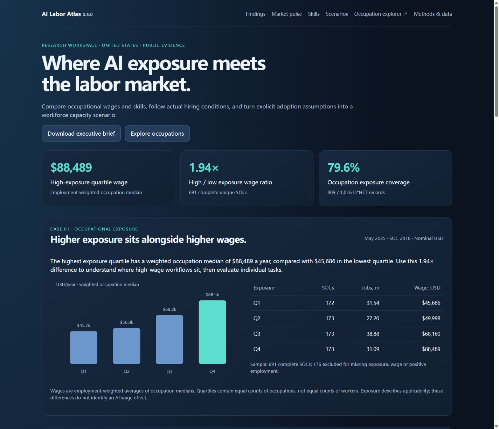

# AI Labor Atlas — Labor Market Intelligence

**Release 0.5.0 · Independent portfolio research by Haojian Dui**

How should workforce teams combine AI exposure, actual recruitment conditions and
the skills required to do the work? Atlas answers with two reproducible public-data
cases, an occupation/task explorer and an explicit workforce capacity scenario.

- **Exposure and wages:** across 691 complete SOC occupations, the highest exposure
  quartile's employment-weighted average occupation median wage is **$88,489**, versus
  **$45,686** in the lowest quartile (1.94×; May 2025). This is a descriptive wage-level
  comparison, not an AI wage effect.
- **Demand and skills:** from January 2022 to September 2026, job openings fell
  **37.3%** in professional and business services and **34.7%** in manufacturing,
  while payroll employment rose 1.6% and 0.8%. Published 2025 industry staffing
  weights show that Critical Thinking and Active Listening both score at least
  3.5/5 in 50.5% versus 31.0% of covered employment. Skill coverage is 91.2% and
  85.8%; this is skill co-occurrence, not estimated economic complementarity.

Start with the [executive brief](docs/reports/executive-brief.md),
[research report](docs/reports/labor-market-intelligence.md),
[figures and structured tables](docs/reports/), or
[two-minute demonstration](docs/demo-script.md).
The [official employer requirement matrix](docs/employer-evidence.md) maps the
delivered work to actual economist roles without claiming client experience.



## Quick start

Requires Python 3.10 or newer.

```powershell
python -m venv .venv
.\.venv\Scripts\Activate.ps1
python -m pip install "ai-labor-atlas[excel]==0.5.0"
python -m ai_labor_atlas.cli build --demo
python -m ai_labor_atlas.cli research
python -m ai_labor_atlas.cli search software
python -m ai_labor_atlas.cli serve
```

The offline occupation demo is deterministic and explicitly synthetic. The bundled
346 monthly observations and 2,007 industry-matrix rows are actual public BLS
source estimates. No API key or running sibling project is required.

For a real-data occupation build and both research cases:

```powershell
atlas download
atlas build
atlas research
atlas serve
```

Download failures identify the exact missing public source; place that registered
file in `data/raw/` and rerun the build. Existing local source files are retained.
To explicitly update the monthly series and industry staffing baseline, use
`atlas market-update` and `atlas staffing-update`, then `atlas research`.
The latter validates the 2025 baseline header and stops for source-vintage review
if BLS changes the table structure. Serving performs no network download.

```powershell
atlas scenario --workforce 1000 --years 3 --annual-adoption 0.25 --output data/research/scenario.json
```

This default scenario releases 129,594 net annual capacity hours in year 3
(64.8 FTE equivalent) under its stated task, savings and training assumptions.
It holds workforce constant; capacity is not a forecast of headcount cuts.
`atlas scenario --help` lists every assumption. The dashboard runs the same model
and exports its annual trajectory and adoption-speed sensitivity.

Contributors working from a clone can instead use
`python -m pip install -e ".[excel]"`. Maintainers can find the token-free
release procedure in [docs/publishing.md](docs/publishing.md).

Atlas reads and writes `data/` under the current working directory. Set
`AI_LABOR_ATLAS_DATA_DIR` to an absolute directory when you want builds and the
dashboard to share a different persistent location.

## Explore the dashboard

The dashboard brings occupational tasks, AI exposure, wages, employment, and outlook together in one visual workspace for comparing roles and exploring changing work. The screenshots below are rendered from the full current-data build (1,016 O*NET occupation records), not the eight-record demonstration dataset.


The dashboard compares AI exposure with wages, projected employment growth, annual openings, and employment scale. It pairs the visual comparison with plain-language metric guidance so users can explore the economic context behind each occupation.

The Career bridge view helps users explore adjacent occupations. It uses structured O*NET importance ratings as the primary profile distance, then shows software overlap, supplemental task evidence, labor-market context, and a practical training hint. The bridge is a descriptive pathway tool. It is not a personal ability estimate, a hiring-probability model, or an employment forecast.

### Optional semantic review

The dashboard can send one selected occupation and its deterministic mapping to an OpenAI-compatible chat-completions endpoint for a second, text-based review. The review is advisory: it cannot change the dataset, exposure values, SOC codes, or summary measures. Leave the variables unset to keep the dashboard fully local and rule-based.

```powershell
$env:AI_LABOR_ATLAS_LLM_API_KEY = "your-key"
$env:AI_LABOR_ATLAS_LLM_BASE_URL = "https://api.openai.com/v1"
$env:AI_LABOR_ATLAS_LLM_MODEL = "your-model"
atlas serve
```

The selected occupation and deterministic mapping evidence are sent only when
the review button is used. A local OpenAI-compatible endpoint may be used
without an API key.

## Data sources and vintages

| Layer | Source | Version/vintage | Use |
| --- | --- | --- | --- |
| Occupation and tasks | O*NET | 30.3 | O*NET-SOC titles, descriptions, tasks, skills, software skills |
| Occupation bridge | O*NET crosswalk | 2019 -> 2018 SOC | Join O*NET occupations to BLS data |
| Wage | BLS OEWS | May 2025 | National employment and wage estimates |
| Outlook | BLS Employment Projections | 2024-2034 | Employment change and annual openings |
| AI exposure | AIOE | source release recorded in manifest | Descriptive exposure comparator |
| Monthly demand | BLS JOLTS via FRED | retrieved 2026-11-16; Jan 2022–Sep 2026 | Unfilled positions, two industry groups |
| Monthly employment/pay | BLS CES via FRED | retrieved 2026-11-16; Jan 2022–Oct 2026 | Payroll jobs and nominal hourly earnings |
| Industry staffing | BLS National Employment Matrix | 2025 baseline from 2025–2035 release | Industry-weighted occupational skills; projected cells excluded |

O*NET-derived files must retain attribution to O*NET and the U.S. Department of Labor, Employment and Training Administration, and must identify modifications. AIOE raw redistribution is disabled by default until its repository license is verified.

The full local build uses the registered public files rather than the demo rows.
The retained occupation baseline contains 1,016 unique O*NET occupations and
18,796 source task statements across 923 occupations, with **79.6% exposure
coverage (809/1,016)**, 94.1% wage coverage, and 94.6% employment coverage.
The earlier README's 79.0% was incorrect and was reproduced and corrected in this
release. Occupation baseline files were acquired in July 2026; their vintages stay
explicit even as monthly market data are updated. The legacy 2024–2034 outlook
is a retained official projection vintage, not the newest BLS projection release.
Release summaries distinguish unique O*NET occupations, unique SOC codes, raw
crosswalk-expanded rows, and one-record-per-O*NET coverage. Research calculations
deduplicate SOC market quantities. Missing source values remain missing.

The occupation bridge uses O*NET 30.3 Essential Skills, Transferable Skills, Knowledge, Abilities, Work Activities, and Software Skills. Exact profiles are preferred; when a parent occupation has no direct structured rating, a family-average profile is marked in the result. This fallback is a data-coverage aid, not an exact occupational equivalence.

### What workers say

The occupation detail view includes an optional space for public worker comments about pay, interviews, management, workload, growth, and work environment. Comments keep their source, date, scope, and link where available. They are displayed as context rather than combined into an overall rating, and they never change the Atlas measures.

To load an auditable local import, create `data/processed/reviews.json` using the contract in [docs/review-data.md](docs/review-data.md). The demo does not invent worker comments. Review imports must respect the source platform's current terms, API rules, attribution requirements, privacy obligations, and user-content rights.

Before starting the dashboard, run the release check against an import file. It reports every row-level error and the resulting occupation, source, and topic coverage without printing review text:

```powershell
python -m ai_labor_atlas.cli validate-reviews --input data/processed/reviews.json
```

The dashboard remains fail-closed: a file that does not pass this check is not partially displayed.

Career Fit can connect to this context through the Atlas server. Set `CAREER_FIT_ATLAS_URL=http://127.0.0.1:8765` before starting Career Fit, then confirm the closest standard occupation in its optional occupation-context panel. Title suggestions are deliberately non-binding because a job title can map to several occupations.

Occupation suggestions use normalized title phrases and compatible role terms. If the supplied title is too broad or does not map cleanly to an Atlas title, the explorer returns no suggestion and asks the user to try a more specific title. This favors a transparent empty result over a plausible but misleading occupation.

For a small set of common nonstandard titles, the versioned [editorial candidate crosswalk](config/occupation_aliases_en.json) provides multiple possible occupation families. These are leads for user review, not official O*NET equivalences or automatic classifications; each candidate includes a mapping note and requires confirmation.

The research rationale and application boundaries are summarized in [the literature-to-product map](docs/literature-map.md).

The full `50 × 10 = 500` deterministic scenario audit, including data-quality, crosswalk, mapping, public-review, and dashboard checks, is documented in [the full audit report](docs/full-500-scenario-audit.md).

## What the numbers mean

`ai_exposure` is an exposure/applicability indicator, not a probability of job loss,
a risk score, or evidence of causality. Its fixed public-build transform is
`100 × (ai_exposure_source_raw + 2.669758) / (1.527667 + 2.669758)`.
Signed source values stay in `ai_exposure_source_raw`; subsetting does not rescale
the display. Values outside this fixed source range require vintage review.

Crosswalk-expanded rows retain `crosswalk_weight` and quality flags. Multiple
targets use disclosed weighted references; research skill cases exclude multi-target
O*NET ratings instead of inventing allocations. Market quantities enter once per
SOC. The legacy `employment_2024` field contains OEWS May 2025 employment;
the new [portfolio.v1 adapter](docs/portfolio-v1.md) exports `employment_jobs`
with an explicit period. Source records use versions, dates, sizes and schemas.

Research exports are written to `data/research/`, including the local downstream
occupation snapshot, two case tables, skills, monthly observations and Markdown
brief. AIOE occupation values are not bundled in distributions because upstream
redistribution rights remain unverified. Published case aggregates are in
`docs/reports/`; full locally generated source/occupation outputs remain local.

## Repository map

- `src/ai_labor_atlas/`: loaders, joins, measures, CLI, and local dashboard
- `config/source_registry.json`: source URLs, versions, licenses, and redistribution status
- `docs/`: requirements, design, and data contract
- `tests/`: deterministic unit tests
