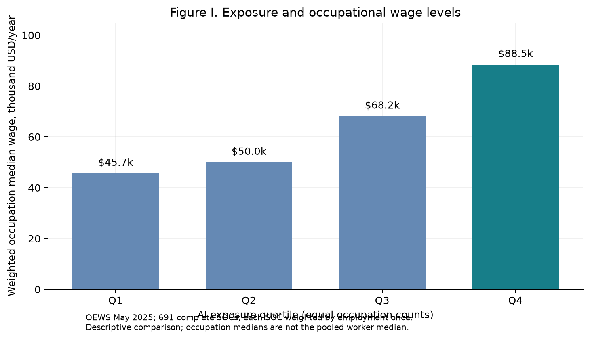
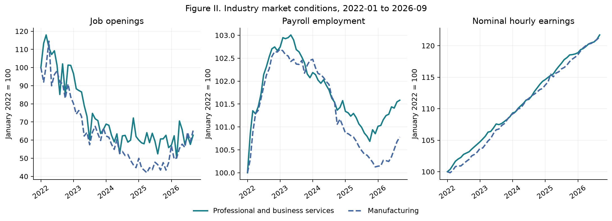
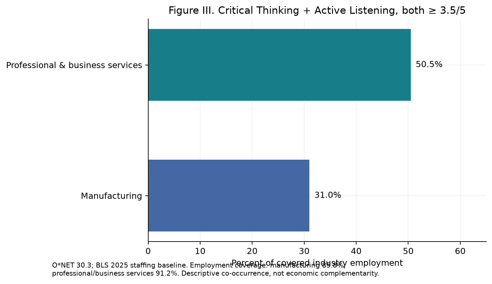

# AI exposure, recruitment conditions and workforce skills

Haojian Dui · AI Labor Atlas 0.5.0 · 16 November 2026

## The workforce question

An occupation's AI exposure identifies work worth examining, but a workforce
decision also needs evidence about hiring conditions and the skills used to
perform that work. This report combines those layers for the United States. The
first case documents how wages and employment are distributed across AI exposure.
The second compares actual recruitment conditions in two industries and uses
published staffing patterns to describe their skill composition. A separate
scenario translates explicit adoption and training assumptions into capacity hours.

The central result is that high occupational exposure is concentrated in relatively
high-wage work, while recent declines in unfilled positions coexist with much
smaller changes in filled jobs. That combination supports task evaluation and
targeted training. It cannot identify how much AI has changed wages, employment
or the return to a particular skill bundle.

## Case 1. Where high-exposure workflows sit

The exposure comparison uses 691 SOC 2018 occupations with an available AIOE
match, annual median wage and positive employment in OEWS May 2025. Each SOC
enters once. Multiple O*NET child occupations sharing the same SOC do not multiply
the occupation's employment. Occupations are sorted by exposure and divided into
four groups with nearly equal numbers of occupations; SOC code resolves ties.

The highest exposure quartile has an employment-weighted average occupational
median wage of $88,489, compared with $45,686 in the lowest quartile, a ratio of
1.94 (Table I in the [executive brief](executive-brief.md)). Figure I shows the
increase across all four groups. These are average occupation medians, weighted
by each occupation's employment. They are neither pooled worker wage medians nor
individual wage premiums. All values are annual nominal USD at the May 2025 wage
vintage.

The four quartiles account for 31.54, 27.20, 38.88 and 31.09 million jobs in this
complete sample. Equal occupation counts therefore do not imply equal worker
counts. The result indicates that an evaluation program focused on exposed work
will often encounter relatively expensive labor inputs. It does not establish
that exposure raises wages, or that all tasks in these occupations can be
automated. Education, occupational sorting, industry composition and many other
factors can generate this cross-sectional relationship.

Coverage is a material part of the measurement. AIOE is available for 809 of
1,016 O*NET occupation records, or 79.6%; the complete wage/exposure sample is
smaller because it is defined at unique SOC level and requires both wage and
employment. Of 867 unique target SOCs, 176 do not enter that complete sample.
The product retains those records with missing fields instead of replacing
their missing values with zero. Table I is a description of the covered sample,
not an estimate for unmatched occupations.

The AIOE source is signed and standardized. Atlas retains that source value and
applies a fixed monotone display transform using source bounds −2.669758 and
1.527667. The display lies between 0 and 100; it is not a percentage of tasks
automated or a probability of job loss. The source uses SOC 2010; Atlas accepts
only conservative one-to-one relationships in its official SOC 2010→2018 bridge.
Splits and merges remain unmatched. Changing a dashboard filter does not change
an occupation's displayed exposure.

## Case 2. Recruitment cooled while the stock of jobs held up

Industry demand is measured with BLS JOLTS unfilled positions, not occupational
employment or future annual openings. The monthly series compare professional
and business services with manufacturing. CES payroll jobs and average hourly
earnings provide separate measures of filled positions and nominal pay. All six
series are seasonally adjusted and use the same January 2022–September 2026
endpoints. October CES observations are available in the underlying snapshot,
but are omitted from this endpoint comparison because JOLTS ends in September.

Professional and business services openings declined from 2.089 million to
1.310 million, or 37.3%; manufacturing openings declined from 895,000 to 584,000,
or 34.7% (Table II in the brief). Over the same window, payroll jobs increased
1.6% and 0.8%. Nominal hourly earnings rose 21.7% and 21.4%, respectively.
Figure II puts the three measures on a common January 2022 index.

The openings decline describes a weaker recruitment margin relative to the
starting month. The much smaller employment change describes the accumulated
stock of jobs. The two can move differently as hiring, separations, vacancy
duration and employer plans change. These comparisons do not decompose those
channels and do not assign the decline to AI. January 2022 was a period of
unusually strong vacancies; the chart shows the path so the endpoint does not
stand in for a fitted trend. Source estimates are revised, and the retained
snapshot represents the data retrieved on 16 November 2026 rather than the
information available in real time at each historical date.

The earnings increases are nominal. They do not establish gains in purchasing
power. CES average earnings can also change when the composition of employees
changes. They should not be interpreted as the wage growth of a fixed set of
workers or as the change in the OEWS occupational medians in Case 1.

## The skills behind those industry comparisons

The industry skill comparison uses the 2025 baseline of the BLS 2025–2035
National Employment Matrix. Projected 2035 values are not imported into this
analysis. Manufacturing uses the published 31–33 group. Professional and business
services combines disjoint NAICS 54, 55 and 56 matrices. Only leaf occupation
rows are summed; hierarchy totals and subgroups never enter as additional jobs.

O*NET 30.3 importance ratings are joined through exact occupation keys. Observed
O*NET children are averaged equally within SOC, then weighted by the industry's
published baseline employment. Multiple-target O*NET mappings, unmatched BLS
aggregate occupations and unavailable ratings do not receive invented
allocations. Industry coverage uses published total employment, so suppressed
or unmatched employment remains in the denominator. The resulting skill coverage
is 85.8% for manufacturing and 91.2% for professional and business services.

Critical Thinking averages 3.30/5 in covered manufacturing employment and 3.51/5
in covered professional and business services employment. Active Listening
averages 3.34 and 3.66, while Programming averages 1.57 and 1.79. These differences
describe weighted occupational requirements within the covered portions of the
industries; they are not measures of current advertised skill demand.

Figure III focuses on a concrete bundle: both Critical Thinking and Active
Listening importance must be at least 3.5/5 in the SOC profile. That condition is
met in 31.0% of covered manufacturing employment and 50.5% of covered professional
and business services employment (Table III in the brief). The 3.5 threshold is
an explicit analytical rule, not a validated hiring cutoff. The result is
descriptive co-occurrence. Demonstrating economic complementarity would require
evidence about returns or production that this dataset does not supply.

The occupation-family view provides a second way to interrogate the same O*NET
ratings, with national OEWS employment weights. Computer and mathematical
occupations have Critical Thinking importance of 3.86/5 and Active Listening
importance of 3.69/5; Programming averages 3.31/5. A training plan built solely
around tools would miss substantial reasoning and communication requirements.
The explorer lets the user inspect a specific occupation's task statements and
the exact profiles behind its Career bridge before translating an average into
an individual work sample.

## A bounded adoption and training scenario

The scenario laboratory holds a workforce and its annual workload constant.
The user specifies annual adoption among workers who have not yet adopted,
automation and augmentation task shares, time savings within those shares,
training hours per new adopter, augmentation training effectiveness and a
horizon. The two task shares cannot sum to more than one. All parameters are
assumptions; occupational AIOE is not converted into any of them.

At year t, cumulative adoption is `1 − (1 − annual_adoption)^t`. Annual gross
capacity hours are workforce × annual hours × cumulative adoption × the sum of
the automation saving share and the training-adjusted augmentation saving share.
Training time is charged only to the new adopters in that year. Net capacity can
be negative when training time exceeds the assumed saving. The tool preserves
that result.

The default illustration has 1,000 workers, 2,000 hours per worker, a three-year
horizon and 25% annual adoption. Automation covers 15% of task time with a 60%
saving; augmentation covers 25% with a 20% saving and 50% training effectiveness.
Training requires 24 hours per new adopter. Year-3 net annual capacity is
129,594 hours, equivalent to 64.8 units of 2,000-hour annual capacity. Halving or
increasing annual adoption by 50% gives 73,621 and 170,332 hours at the same
horizon. These are conditional accounting scenarios, not fitted forecasts or
estimates of jobs lost. No reduction in workforce is built into the model.

The next useful organizational evidence is a measured workflow: baseline task
time, output quality, realized adoption, supervision cost, training time and the
work to which released time can be redeployed. The scenario makes those data
needs concrete. A capacity result alone cannot establish a financial return,
service-quality improvement or optimal staffing decision.

## Reproduction and delivery

`atlas build` processes the registered public occupation sources. `atlas research`
regenerates the two cases, their denominators, skill profiles, co-occurrence and
the local downstream snapshot. `atlas market-update` explicitly refreshes six
monthly sources; `atlas staffing-update` explicitly refreshes four industry
matrices. The latter validates the 2025 baseline header so a later release cannot
silently replace the vintage. `atlas serve` opens no network connection during
generation and serves the research workspace alongside the original occupation
APIs. The exact commands, offline demo and optional report-figure regeneration
are documented in the README and [reproduction guide](../reproduction.md).

The [selected evidence manifest](evidence-manifest.md) lists this report's
aggregates and exhibits. Full occupation outputs, including signed AIOE, remain
local. The new `portfolio.v1` occupation adapter preserves source-native keys,
taxonomies, units, periods, status and missing values so another project can
consume a dated snapshot without depending on a live Atlas service.

## Sources

- [BLS Occupational Employment and Wage Statistics tables](https://www.bls.gov/oes/tables.htm), May 2025; retained local acquisition July 2026.
- [O*NET database](https://www.onetcenter.org/database.html), 30.3; [official crosswalks](https://www.onetcenter.org/crosswalks.html). Adapted under CC BY 4.0 with attribution to USDOL ETA.
- [AIOE public source repository](https://github.com/AIOE-Data/AIOE). Felten, Raj and Seamans (2021), *Strategic Management Journal* 42(12), 2195–2217. Occupation-level redistribution rights remain unverified; no raw AIOE file is bundled.
- BLS JOLTS via FRED: [professional/business services](https://fred.stlouisfed.org/series/JTS540099JOL), [manufacturing](https://fred.stlouisfed.org/series/JTS3000JOL).
- BLS CES via FRED: [professional/business services jobs](https://fred.stlouisfed.org/series/USPBS), [manufacturing jobs](https://fred.stlouisfed.org/series/MANEMP), [professional/business services earnings](https://fred.stlouisfed.org/series/CES6000000003), [manufacturing earnings](https://fred.stlouisfed.org/series/CES3000000003).
- BLS National Employment Matrix: [manufacturing](https://data.bls.gov/projections/nationalMatrix?queryParams=31-330&ioType=i), [NAICS 54](https://data.bls.gov/projections/nationalMatrix?queryParams=540000&ioType=i), [NAICS 55](https://data.bls.gov/projections/nationalMatrix?queryParams=550000&ioType=i), [NAICS 56](https://data.bls.gov/projections/nationalMatrix?queryParams=560000&ioType=i). 2025 baseline, retrieved 16 November 2026.
